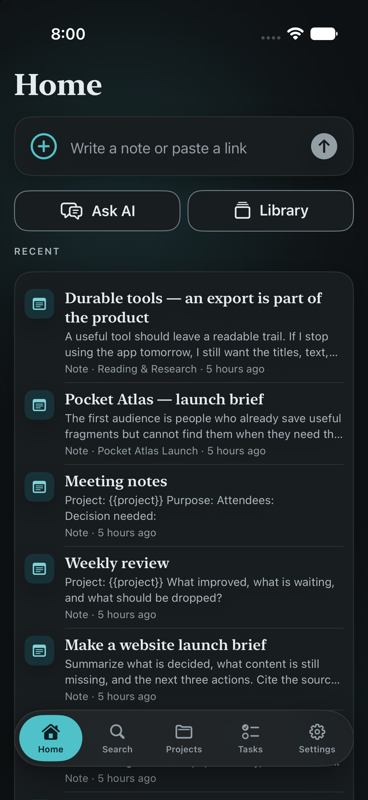
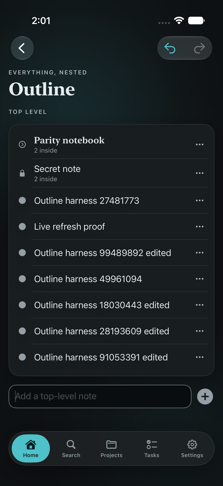
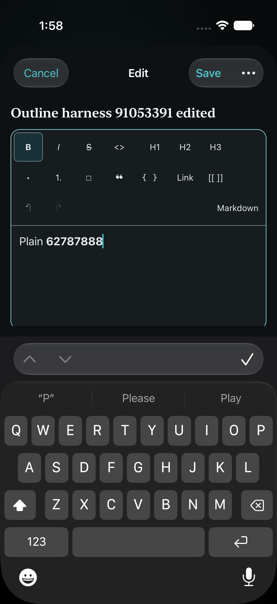
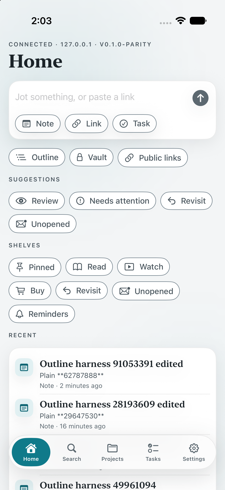
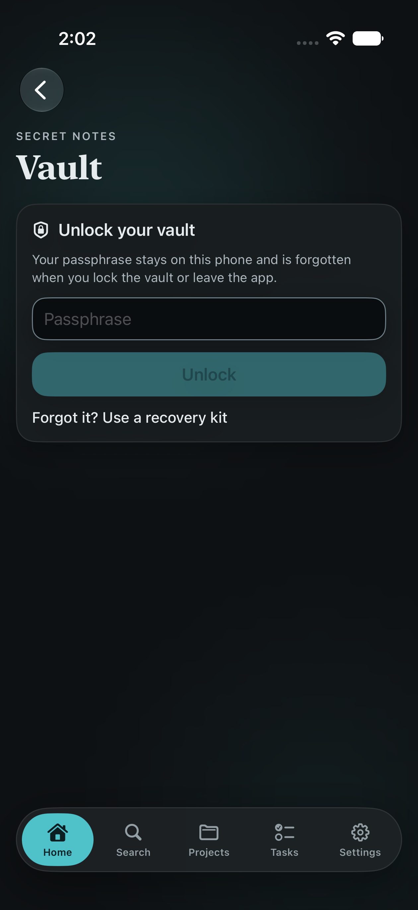

# Petty Memory for iOS

The phone companion for Petty Memory. The library stays on your computer; the phone is a client of the local HTTP API (`petty-memory serve --lan`) over your home network or Tailscale. It keeps its pairing token (Keychain), an outbox of writes that couldn't be sent yet, and a read-only copy of the ordinary library for offline browsing and search. Core on the computer stays the authority: the phone never validates or applies edits itself, it queues them and shows them on top of its copy until the server accepts them.

| Home | Outline | Formatted editor |
|---|---|---|
|  |  |  |

| Light mode | Locked vault |
|---|---|
|  |  |

Screenshots use a disposable fictional library. Outline, editing and vault captures come from the native UI tests.

## Requirements

- Xcode 26 or newer, iOS 17.0+ deployment target, Swift 6 language mode.
- [XcodeGen](https://github.com/yonaskolb/XcodeGen). The `.xcodeproj` is generated from `project.yml`; run `xcodegen generate` after adding files or changing `project.yml`.
- A Petty Memory server: `petty-memory serve --lan` on the computer that holds the library.

## Build and run

```bash
cd apps/ios
./scripts/build-editor.sh        # bundles the shared formatted editor (needs the repo's npm dependencies)
xcodegen generate
xcodebuild -project EnveMemory.xcodeproj -scheme EnveMemory \
  -destination "platform=iOS Simulator,name=iPhone Air" build
```

To run on a device, set `DEVELOPMENT_TEAM` in `project.yml` (both targets share it) and register the App Group `group.com.enve.memory` for `com.enve.memory` and `com.enve.memory.share`. Simulator builds are ad-hoc signed and need no team.

## Pairing

On the computer:

```bash
petty-memory serve --lan
petty-memory clients pair "My iPhone"      # prints enve-memory://pair?url=…&token=…&name=… links, one per network address
```

Then on the phone, either:

- **Scan** the QR code of a pairing link (camera, real devices only),
- **Open** the link (AirDrop it, or tap it in Messages or Notes). If the phone is already paired it asks before replacing the pairing,
- **Paste** the link on the onboarding screen, or
- **Enter** the server address (`http://192.168.1.20:49231`) and the `em_…` token by hand.

`clients pair` grants `read` and `write`; add `--scope secrets` for a phone that should use the vault. Nothing is stored until `GET /status` and `GET /whoami` both succeed. Settings shows the address, device name, server version and granted scopes. Unpairing deletes the token from the phone; revoke it on the computer with `petty-memory clients revoke <id>`.

For the simulator, which shares the Mac's network, a loopback link works without `--lan`:

```bash
petty-memory --home /tmp/em serve --port 49871
petty-memory --home /tmp/em clients pair "iPhone Sim" --port 49871 --json   # take the token from the output
xcrun simctl openurl <udid> "enve-memory://pair?url=http%3A%2F%2F127.0.0.1%3A49871&token=<token>&name=iPhone+Sim"
```

## What it does

- **Home**: a quick-capture bar (a bare URL becomes a link, anything else a note), shortcuts to new note, link and task, the outbox status, and recent items 30 at a time ("Show older" follows the server's `before=<updatedAt>,<id>` cursor).
- **Shelves** (on Home): Pinned, Read, Watch, Buy, Revisit, Unopened (30 days) and Reminders, each a filtered `/items` list.
- **Search**: debounced hybrid search with type and project filters. Matched terms are highlighted, and each hit notes quietly whether it matched on words, meaning or both.
- **Projects**: the same briefing an AI gets from `get_project`, with standing instructions, the memory document rendered as Markdown, the decision log (superseded decisions struck through and dimmed), open tasks you can complete, and recent items.
- **Tasks**: active tasks grouped by project, with due dates and priority, loaded 50 at a time as you scroll (`offset`). Tap the circle or swipe to complete.
- **Item detail**: pin toggle, intent chips (Read / Watch / Buy / Revisit, marked "Guessed" while the server's guess stands), a "Remind me" menu (Tonight, Tomorrow, This weekend, Next week, or a picked date and time), the AI summary with suggested tags and project and an Accept button, title, site, byline and date, your note, tags, the task card, attachments (downloaded and previewed with Quick Look), the archived copy in a quiet reading column, relations, and "Open original" in Safari. Archived text is data: only `http`, `https` and `mailto` links in it are followed.
- **Share extension**: accepts links, text, images and files from any share sheet. Links and files get intent chips, every share gets "Remind me" chips (files send them as `X-Intent` / `X-Remind` headers), and every share gets a project picker (from the cached project list), tags and a note. Links and text go to `POST /capture`, files stream to `POST /files`. When the server can't be reached the share goes to the outbox and the sheet says "Saved — will sync when you're back on your network".
- **Outbox**: every write (captures, new items, task completions, uploads) goes straight to the server when it can and into the outbox when it can't. The app flushes it on launch and foreground, every 20 s while something is waiting (honouring backoff), and from a `BGAppRefreshTask`. Settings lists queued entries with retry and discard.
- **Reminders as local notifications**: after every sync (launch, foreground, each write, background refresh) the app mirrors `GET /reminders` into `UNUserNotificationCenter` requests keyed `enve-memory.reminder.<item id>`, adding, moving and cancelling as the server changes, so the phone reminds you even when it can't reach the server. Tapping one opens `enve-memory://item/<id>`. Permission is asked the first time you set a reminder (or from the Reminders shelf), never at launch. A capture or share that sets a reminder schedules its notification right away (the share extension only when the app already has permission): under the item's id when the server answered, or under the outbox entry's id while it waits, which the first sync after the entry is sent swaps for the real one.
- **Opened signal**: "Open original" and attachment previews report `POST /items/:id/opened`, which drives the Unopened shelf.
- **Appearance**: System, Dark and Light modes plus true-black OLED, shared with the share extension.
- **Outline** (Home → Outline, or "Show in outline" on any item): branches load 50 children at a time with a breadcrumb path; add notes at the top level or inside a branch; move up/down, indent, outdent, "Move to…" a picked branch and sibling (the picker pages 100 rows at a time), and merge a note into the one above. Moves always place with `beforeId`; positions are never computed on the phone. These are journalled actions (`POST /editor/actions` with a client UUIDv7 action id), so the outline's Undo and Redo buttons reverse whole actions, named for what they'd undo. Undoing an action that hasn't been sent yet takes it back out of the outbox when nothing queued after it could depend on it; otherwise it queues `/editor/actions/:id/undo` behind it. A stale undo is reported, never forced.
- **Presentation and checklists**: an item's "Shows as" card sets text/heading/section, low/normal/high attention, a review mark, checklist and hide-completed, and done; checklist progress and reset. Tasks complete by status, everything else by its checkmark. Home's Suggestions open Review, Needs attention, Revisit and Unopened.
- **Editing and references**: the text is edited in the shared formatted editor from `packages/editor` (the same one as the desktop and browser apps), running in a web view that loads only the bundled `EnveMemory/Resources/Editor` files over a private `petty-editor:` scheme, with no network, no website data and no navigation. It keeps unchanged Markdown byte for byte, has its own toolbar (formatting, lists, checkboxes, links, references, its own undo and redo, "Edit as Markdown"), and asks the app for links (web and email only) and references (the item picker). A build without the bundled editor uses a Markdown field with formatting buttons (bold, italic, heading, bullet, checkbox, quote) and "Link to an item", which inserts `[[item:<id>|label]]` (the picker pages recent items with the `before` cursor and widens a search up to the server's 200). Saving is one undoable action carrying the text it started from; typing keeps the field's own undo. On iOS 18, "Split at cursor" splits a note's title (or, in the Markdown field, its text) at the caret, sent as a UTF-16 offset with a client id for the new note, saving any unsaved text in the same action. References render as in-app links showing the target's current name; backlinks and explicit connections (add, remove) appear on the item.
- **History**: an item's versions, a version's snapshot compared with the newest or the one before, and restore as a new change. Libraries upgraded from before history show a labelled starting point. A restore (or an AI undo) whose files are no longer on the computer says which ones didn't come back; a restore that waited in the outbox reports it when it's sent, as a notice in Settings › Outbox.
- **Edit with AI**: ask the computer's configured AI for a proposal, review each change before/after, apply the ones you keep (all together or none), and undo them afterwards unless the item changed again. Online only; turning on "Auto-organize" is a separate opt-in.
- **AI chat** (Home → AI chat): Ask gives cited answers and follow-ups, with optional project filtering. Change notes proposes edits within a chosen branch and opens the existing review without another model call. Conversations stay in memory for this screen unless you save them, and carry only recent exchanges within the server limits. Unsaved chats are never cached or queued; explicitly saved transcripts can be read as ordinary cached notes. Failed requests keep the draft; changing mode or scope starts over.
- **Organize library** (the Organize chat mode): say “Organize all notes about gardening into a PARA system.” No branch selection is needed. Review the destination, headings, original placements and carried-child counts, then untick false matches and move the rest together. Existing contents, files, tags and project filing stay intact. Open the resulting outline and return to chat for guarded Undo. It needs a connection and write access; changed or oversized scopes are refused. [Chat guide](../../docs/AI_CHAT.md).
- **Saved chats** (AI chat's Save button, Home → Saved chats): a conversation is stored only when you tap Save (`POST /conversations`, at most 100 alternating messages and 200,000 characters; the oldest exchanges are left out first and the alert says so). Saving again updates the same conversation; changing mode, project, notes or topic starts a new, unsaved one. Saved chats are listed, opened and archived (never deleted) through the uncached client and only while connected. Reopening one restores its context and its replies as plain text: an earlier proposal is only its summary and can't be applied again. Opening a saved chat over an unsaved one, or starting a new chat, asks first. "Save as note" turns an answer into an ordinary note whose `[n]` citations become `[[item:…]]` references, plus a list of its sources.
- **Actions** (the AI chat mode): from chosen notes or every note about a topic (with an optional project), the AI proposes tasks, tags, reminders and a brief. Each is reviewed with a checkbox; nothing changes until Apply (`/ai/actions/apply` with the ticked ids), and Undo (`/ai/actions/undo`) is refused once something it touched changed again. A stale proposal is refused with your ticks kept; operations this version can't show are never applied.
- **Organize suggestions**: candidates found by meaning rather than by keyword are marked "Suggested · related in meaning", and the review explains they come from a bounded search. When the computer's semantic search is off or unavailable, organization uses keyword matches only.
- **Daily review** (Home → Daily review): what's due from `GET /review`, filterable by project, with progress. Open any card as an ordinary item, then choose Tomorrow, In a week, In a month or any number of days (1–3650). Online only and never queued, so the schedule stays the same on every device; a read-only pairing can look but not reschedule. Review sends no notifications of its own; set a reminder for a nudge.
- **Suggested connections** (item detail → Find connections): unlinked mentions, related notes and possible duplicates from `GET /items/:id/insights`, found without AI and bounded ("Looked through 500 of 1,200 items"). Connect adds the ordinary "related to" connection. A duplicate opens a merge preview that says what happens: the text joins the kept note, notes inside move with it, and the other note is archived with its files rather than deleted. Merge is refused if either note changed after the preview, and Undo reverses it through the editor's undo.
- **Image text** (New → Image): choose a photo, a file or (on a device) the camera only when you tap it; "Extract text" reads it with Vision on the iPhone, off the main thread, from a downsampled upright copy. The text is an editable draft, and saving uploads the original image with the text as its note, through the outbox like any file. Images already in the library offer "Extract text" on their attachment row, read by your computer (`POST /capture/ocr`, bundled English Tesseract) and saved as a new note only if you ask. Neither path uses the AI provider. Camera capture and Vision accuracy still need a physical-device run.
- **Enve import** (Settings → Import Enve highlights, or Getting started): choose a JSON or Markdown export up to 2 MB; the computer previews the passages, books and skipped entries, then imports them into the project you pick. Importing the same export again skips what you already have. Only the chosen file is read, and source links are shown, not opened. Enve's current export carries no book identifiers or source links, so imported passages don't link back into the book and aren't kept in sync; only interchange files that supply links show them.
- **Getting started** (Home): a dismissible checklist pointing at capture, daily review, Enve import and optional AI setup. It never changes the library or turns AI on, and Settings can bring it back.
- **Dictation** (in AI chat and new notes): "Dictate" asks for speech-recognition and microphone permission the first time it's tapped, never before, then types what it hears into the draft after what's already there, replacing its own partial text rather than repeating it. It recognizes on the phone when the language supports it; otherwise the screen says Apple's speech service does it. Petty Memory doesn't save audio, and Send stays disabled while it listens so you can check the draft first. It stops on Stop, starting over, leaving the screen, going to the background, an audio interruption or a microphone change, and errors are shown with a way to Settings when permission was refused. Results that arrive after it stops are ignored.
- **Vault** (only when the token has the `secrets` scope, which pairing grants only with `--scope secrets`): secret notes are sealed on the phone (PBKDF2-SHA256 600,000 rounds, AES-256-GCM bound to a client-made UUIDv7) and sent as ciphertext. The passphrase, keys and opened text live only in memory and are dropped on lock, on leaving the app, and on re-pairing. The phone never uses the host-decryption vault routes. Notes sealed in the computer's older scrypt format open only on the computer. The list loads 50 at a time with "Show older secret notes", fetched only through the uncached session, and shows secret notes nested under the secret notes they sit in (placement is visible metadata; text isn't).
  - **Nesting**: a secret note can hold other secret notes ("New secret note inside", sent with `parentId`) and move between them or to the top level through the outline route; nothing ordinary goes under a secret note, though a secret note may sit inside ordinary content.
  - **Files**: "Add a file" reads the file on the phone and seals it as one envelope (`PMVF1` frame with the real name and type inside, AAD `petty-memory:file:v1:<item>:<attachment>`, at most 20 MB) sent with `PUT /vault/items/:id/attachments/:attachmentId`; the computer stores only "Encrypted attachment.pmv". "Save…" downloads the envelope, decrypts it here and hands it to the system save sheet: it is never previewed or opened in the app, and the decrypted bytes are dropped when saved, dismissed or locked. Removing a file keeps it in the note's history.
  - **Recovery kit**: while unlocked, "Make a recovery kit" wraps the passphrase with a random key and shows that key once as a `pmr1_…` code, with the kit offered as a file to save. Both are needed (plus a library backup) to open the vault again from "Forgot it? Use a recovery kit"; neither is sent to the server or stored by the app, the code and kit leave the screen on lock or background, and the recovered passphrase is never shown.
  - **History**: restoring a secret note's version uses `POST /vault/versions/:id/restore` (ciphertext only, `secrets` scope); missing files are named.
- **Public links**: create a read-only `<server>/s/<token>` link for an item and what's inside it, leaving children out and choosing an expiry; the link is shown once. List and revoke links from Settings. The `/s/` page is served by the desktop app, `petty-memory serve` and the web launcher (`apps/web`).
- **Saved views** (Home → Saved views): a named search plus filters (project or Inbox, type, task status, tag, intent, attention, pinned, reminder, review mark, unopened links) that all have to hold. Results come from `GET /views/:id/items`, newest first, 50 at a time with the server's `next` cursor; secret notes, archived items, saved-view definitions and templates never show. Create, edit and remove (with confirmation; only the definition is archived) need a connection.
- **Templates** (Home → Templates, and "Save as template…" in a note's menu): saving copies the note and every note inside it on the server, leaving the source alone; a branch holding anything other than notes is refused whole. Using one picks a title, a project (Inbox by default) and a date for `{{date}}`, then opens the new note. Templates are edited as ordinary notes. Both actions need a connection.
- **Offline copy**: while the app is in the foreground and connected, it pulls the read-only `GET /library` feed 200 changes a page, saving its cursor with every page so an interrupted pull resumes, then long-polls `GET /changes` (one request for the whole app, cancelled in the background, backing off on failures) and pulls again when anything changes, reloading open screens once the pull has saved something new. A page counts only once its data and the cursor after it are on disk: a failed save is reported in Settings and retried from the same page, and overlapping refreshes run one after the other. The copy holds every ordinary item with its placement, archived text and file list, projects (and their briefings), and connections; secret notes never arrive (their ids come as deletions), and AI suggestions are dropped. A restored or replaced library rebuilds it from the start. Settings shows how much is saved and when it was last confirmed current. It lives per server and token and is deleted on unpair or re-pair. A refused token is reported, never answered from the copy.
- **Offline**: when the server can't be reached, the outline (including branches never opened), items, references, checklist progress, search (every word must appear in the title, text, tags, project, address or site), shelves, Home, projects, briefings and tasks answer from the copy or the last saved answer, whichever is newer, with an "Offline · saved copy" banner showing its age. Writes queue in the outbox in order and later ones wait behind earlier ones. New notes get a client UUIDv7, so they can be opened, edited, moved and given children before they're sent; queued moves, merges, splits, checks (with everything below a checked item) and presentation changes show at once, and rows queued past the end of a partly loaded branch are counted but held back until the rows before them load. Text edits carry their base text, so one that conflicts with a newer edit on another device, or a new note whose place is gone, is kept for you to save as a new note rather than overwriting. Vault, history, shares and AI are never saved and need a connection. Saved views and templates are never queued: offline, their create, edit, remove and use buttons are disabled with the reason shown, and their lists and results show the server's last saved answer under "Offline · last saved results" rather than being recalculated from the copy. Template notes and saved-view definitions stay in the copy as ordinary notes, still marked as such.

## Architecture

```
apps/ios/
  project.yml                XcodeGen spec: app, share extension, package and UI tests in the scheme
  Packages/EnveMemoryKit/    Foundation-only Swift package shared by both targets
    Models.swift             Codable models matching packages/core/src/types.ts
    Endpoint.swift           Every API call as a Codable value (the outbox persists these)
    APIClient.swift          async/await URLSession client, file upload/download
    APIError.swift           {error:{code,message}} → typed errors, retryability
    Pairing.swift            Pairing link parser, stored pairing
    CredentialStore.swift    Keychain store in the App Group access group
    Outbox.swift             File-per-entry queue in the App Group container, strict order, backoff, idempotent flush
    Editor.swift             Journalled editor commands and actions (`/editor/actions`), refused-draft recovery
    Workflows.swift          Saved views and templates: models, metadata and routes
    Chat.swift               AI status, chat requests cut to the server's limits, cited answers and proposals, dictation drafts
    Organization.swift       Library organization proposals (kept verbatim for apply), hierarchy, selection, apply and undo routes
    Conversations.swift      Saved conversations: models, limits, save/list/archive routes
    Actions.swift            AI action proposals (tasks, tags, reminders, briefs), apply and undo routes
    Review.swift             Daily review cards and scheduling
    Insights.swift           Connection suggestions and duplicate merge previews
    Imports.swift            Enve highlight import previews and results, OCR extraction
    PendingEdits.swift       The outbox read back in order as an overlay: text, checks, presentation, new notes, placements
    OfflineLibrary.swift     The per-server replica from `/library` and `/changes`, answering ordinary reads offline
    AppGroup.swift           Shared container paths and settings (project cache, theme)
    Share.swift              NSItemProvider → SharedContent → API calls
  Shared/                    SwiftUI compiled into both targets
    Design/                  Hearth tokens: palette, type, spacing, radius, cards, chips, buttons, background
    Components/              ProjectPicker
  EnveMemory/                App target
    App/                     App entry, root view, router, Mantel dock
    Services/                Connection, OutboxService, EditorHistory, OfflineSync, ProjectStore (@Observable, via @Environment)
    Components/              Markdown renderer, item rows, empty/error states
    Features/                Onboarding, Home, Search, Projects, Tasks, Items, Outline, Capture, Settings, Vault, History, AI, Sharing, Workflows, Review, Imports
    Resources/Editor/        Host page and bridge for the shared editor; editor.js/.css are built by scripts/build-editor.sh
  EnveMemoryShare/           Share extension (UIHostingController + SwiftUI sheet)
```

Design choices worth knowing:

- **Every write carries an `Idempotency-Key`.** The key is generated when the request is built and persisted with the outbox entry, so the direct attempt and every retry, including from the share extension, share one key. If a response is lost after the server applied the write, the retry gets the original response (`Idempotent-Replayed: true`) instead of creating a second item.
- **Reminder words are resolved on the phone.** "Tonight" becomes an ISO time (20:00, 9:00 or Saturday 10:00, matching the server's rules) in the phone's time zone at the moment you tap it, so a capture that waits in the outbox until tomorrow still means tonight.
- **One path for writes.** `OutboxService.submit` tries the server and falls back to the outbox only for retryable failures (unreachable, timeouts, 5xx, 401). A 400 or 413 is shown to the user, since resending the same request can't succeed.
- **The share extension never flushes.** It tries the server once, and anything left goes to the outbox for the app to send. Only one process drains the queue, so flushing never double-sends in-process; concurrent `flush` calls collapse into one.
- **The pairing lives in the Keychain** as one item in the `group.com.enve.memory` access group, accessible after first unlock (so background refresh works while the phone is locked). If an unsigned build lacks the entitlement, the store falls back to the app's default access group.
- **The design system is local.** `Shared/Design` uses Petty Tracker's cool gray surfaces and teal accent (`#0F7A8A` in light mode, `#4FC1C9` in dark mode), plus true-black OLED surfaces. It keeps the serif display type with Dynamic Type, the 4 pt spacing rhythm, radii (inner 14, card 20, bar 30), floating Mantel dock with a published `bottomBarInset`, and Reduce Motion-aware ambient background. Stored `ink`/`paper` preference values remain compatible; their labels are Dark/Light. Long text sits on opaque surfaces with no glow behind it.

## Tests

The package tests use Swift Testing and run on macOS or the simulator:

```bash
cd apps/ios/Packages/EnveMemoryKit && xcrun swift test          # macOS, a few seconds
cd apps/ios && xcodebuild test -project EnveMemory.xcodeproj -scheme EnveMemory \
  -destination "platform=iOS Simulator,name=iPhone Air"
```

(`xcrun swift` avoids a stale toolchain that `swiftly` may put first on `PATH`.)

They cover the new item fields (tags, intent, pin, opened, reminder, AI suggestions, search previews), shelf queries, reminder presets (including a daylight-saving change), the pure reminder plan (what to schedule, replace and cancel given the server's list, capped at 60 because iOS keeps 64 pending), item deep links, idempotency keys (fresh per write, kept across a lost response and the outbox retry), paging parameters and cursors, pairing-link parsing (valid, invalid and missing fields, `+` as space), request building (paths, strict query and header percent-encoding, bodies), error mapping through a `URLProtocol` stub (envelope codes, non-envelope statuses, connection failures, decoding), the outbox (persistence, strict ordering behind a retryable failure, timestamps that survive rewriting, concurrent flushes, backoff schedule, permanent failures, file uploads, withdrawal, removal), the offline copy against a fake `/library` feed (unopened branches, ancestors, archived text, connections, references, search ranking and snippets, paging that resumes from its cursor, long-poll, moves, deletions and secret evictions, backup resets and device changes, a revoked token, compaction, per-token isolation, nothing secret or AI on disk), the pending overlay (ordered placements across branches, client-id notes with children and edits, partly loaded branches, checks on ancestors, splits with UTF-16 offsets and merges, undo and redo of queued actions), editor action and undo/redo request shapes, refused-draft recovery, restore results with missing files, saved-view and template routes, bodies and decoding (with their metadata kept by the offline copy, which never answers their lists or results itself), AI grouping proposals that keep their temporary ids, AI chat routes and bodies (no idempotency key, never cached), history cut to the server's message and UTF-16 character limits by whole exchanges, answer, proposal and status decoding, dictation drafts that replace partial results and ignore late ones, organization proposals (hierarchy order, headings dropped with their last selected note, carried-item counts, verbatim apply bodies with the selection, receipts, stale refusals), JSON decoding of responses captured from a real `petty-memory serve` 0.1.0 (`Tests/EnveMemoryKitTests/Fixtures`), and the share extension's item-provider → payload conversion.


## Parity regression checks

`xcrun swift test` runs the package checks without downloading models. To include the live encrypted-file API contract, set `MEMORY_TEST_SERVER` and `MEMORY_TEST_TOKEN` to a disposable server/library with the fixed vault fixture seeded (`packages/core/test/fixtures/vault-closeout-v1.json`). The token needs read/write/secrets. Without the server variable that one integration case is disabled.

The `EnveMemoryUITests` target uses the normal pairing, outline/editor and vault interfaces, plus read-only API assertions. Run it on a dedicated simulator with a fictional library. Provide `TEST_RUNNER_MEMORY_PAIRING_LINK`, `TEST_RUNNER_MEMORY_VAULT_PASSPHRASE`, `TEST_RUNNER_MEMORY_VAULT_PARENT_TITLE`, `TEST_RUNNER_MEMORY_VAULT_CHILD_TITLE` and `TEST_RUNNER_MEMORY_VAULT_CHILD_SECRET`. A missing required fixture skips the corresponding tests. `WorkflowsUITests` (select it alone with `-only-testing:EnveMemoryUITests/WorkflowsUITests`) needs only the pairing link: it adds a numbered note, saves it as a template, uses the template, then creates, renames and removes a saved view that finds the copy. It leaves those fixture items (and the archived view) in the library. `ChatUITests` (`-only-testing:EnveMemoryUITests/ChatUITests`) also needs `TEST_RUNNER_MEMORY_AI_FIXTURE=1`, set only when the scratch server's AI is a deterministic fixture that answers questions and proposes at least one change to the chosen note (never a real model or library). It adds a numbered note, asks about it and opens the cited source, switches to Change notes, picks the note, uses a quick starter, checks the server is untouched until review, applies and undoes the proposal, and starts a new chat. It shows the Dictate control and its disclosure but never taps it: speech recognition needs a real device and microphone. `testOrganizeLibraryReviewSubsetOpenAndUndo` (select it with `-only-testing:EnveMemoryUITests/ChatUITests/testOrganizeLibraryReviewSubsetOpenAndUndo`) needs the same fixture, whose planner must take the topic and destination from "Organize all notes about <topic> into <name>." and place every note it's given: it adds two numbered notes, asks to organize them, checks nothing moved before review, unticks one, applies, checks only the other moved, opens the destination, reopens the review and undoes. If the runner pasteboard is isolated, `TEST_RUNNER_MEMORY_UI_TYPE_PAIRING_LINK=1` types the disposable link instead. XCTest records typed fixture values: never use real credentials or a personal library. The vault case saves an encrypted kit with a unique filename in the simulator's Files storage and checks locking. Explicit snapshots omit the recovery code; automatic recordings and activity logs still contain fixture data. See [the verification record](../../docs/PARITY_VERIFICATION.md) for authoritative results.

`PowerUITests` adds saved-chat continuation, selected tasks/tags/reminders with Undo, review scheduling, duplicate merge/Undo and attachment OCR. Set `TEST_RUNNER_MEMORY_POWER_FIXTURE=1` with the disposable AI fixture. Seed active ordinary items titled `Garden meeting`, `Duplicate garden plan` (similar body), and `OCR field card` with `packages/ingestion/test/fixtures/ocr-note.png` attached; leave at least two knowledge items due for review. The action fixture must propose a task `Build raised beds`, tag `gardening`, reminder `2026-12-20T12:00:00Z` and brief `Garden brief` from `n1`.

The extra `testNativePhotoRecognitionAndHighlightFileImport` requires `TEST_RUNNER_MEMORY_NATIVE_CAPTURE_FIXTURE=1`: on the dedicated portrait iPhone Air, make the OCR PNG the newest photo and put an Enve JSON export in the first visible Files Recents slot. Use book `Native Fictional Garden`, passage `Plant tomatoes after the final frost.`, position `0.25`. These system picker tiles use verified coordinates after waiting for presentation. Never enable this fixture flag on a personal simulator. [Everyday workflow verification](../../docs/POWER_VERIFICATION.md) records the six passing native journeys and the physical-device gates.
