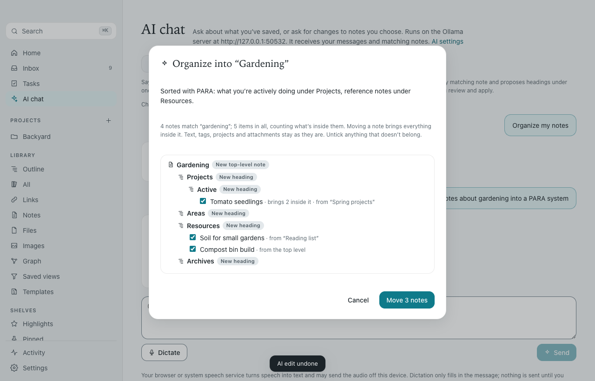
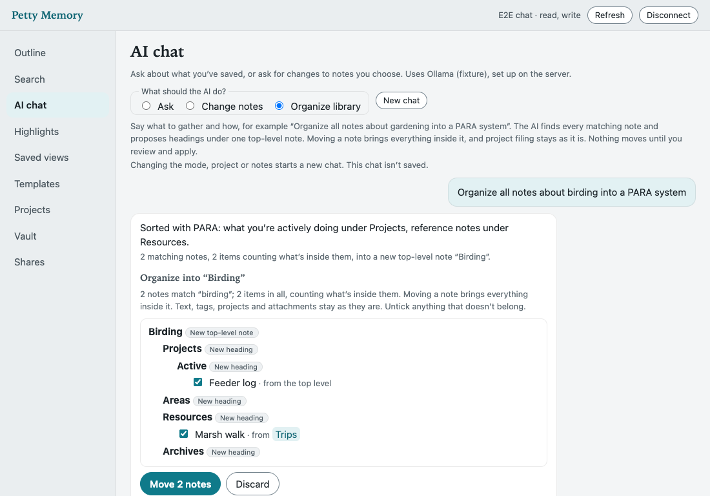

# Chat, dictation and organizing a topic

Open **AI chat** on desktop or in the browser, or from Home on iPhone. Configure a provider on the library's host first: Settings → AI on desktop, or `petty-memory ai use` for a self-hosted server. The phone and browser use that host's provider; they do not need their own AI keys.

## Organize notes across the library

Choose **Organize library**, then type or dictate an instruction such as:

> Organize all notes about gardening into a PARA system.

You do not have to gather the notes into one branch first. The AI extracts the topic and the requested system, and the host finds matching ordinary notes throughout the library, including notes filed in different projects. The AI proposes headings and places each matching branch under one of them. If the topic or system is unclear, it can ask a follow-up question in the same conversation.

The PARA example uses Projects, Areas, Resources and Archives, following [Tiago Forte's method](https://fortelabs.com/blog/para/). You can also request your own structure, such as grouping gardening notes by season.

Review the proposed destination, headings and note placements. The preview counts matching notes and the children that would travel with them. Uncheck any branch you want to leave where it is, then apply the selection. A proposal alone changes nothing.

Applying preserves the notes' identities, text, tags, project filing, references and attached files. Moving a parent carries its children, so nested matches appear once in the move list. Headings are ordinary outline notes, not filesystem folders. An existing top-level note with the destination's exact name is reused; its body stays intact. Duplicate destination names must be resolved before organizing.

**Undo** restores the previous placements and archives headings created by that operation. New work under the destination blocks this quick undo; use History to choose a recovery instead. If notes change or new matching notes arrive while a proposal is being prepared or reviewed, applying it is refused and you need a fresh proposal.

Topic discovery uses the library's keyword index, rather than treating a semantic top-results list as every relevant note. Multi-word topics require every search term to match, so adding a specific term narrows discovery. When semantic search is available, up to 50 more notes found by meaning are added and marked **Suggested**; they come from a short top-results list, so check them before applying. If semantic search is off or unsupported, discovery uses keyword matches only, and a failed semantic lookup is noted in the proposal. Review the matches for false positives and missing synonyms. A request can cover up to **150 matching notes and 500 affected items**, including suggestions, with up to 40 new headings. Broader requests are refused with a request to narrow the topic; they are never silently applied to a partial result. Secrets, archived items, templates and saved-view definitions are excluded from matching. A matching branch that contains secret content is refused whole before it reaches the AI. Carried children, including archived ones, count toward the size limit.

## Questions and changes to one branch

- **Questions** answers from the library with numbered source links. Follow-ups retain the recent conversation, so you can ask about a previous answer. Project filtering limits retrieval.
- **Change notes** takes an explicit note and proposes text, presentation and structural changes within it. Review individual changes before applying. This remains useful for rewriting or turning an existing list into a checklist.
- **Suggest actions** (Actions on iPhone) proposes tasks, tags, reminders and a brief from a chosen branch or a keyword topic. Tick the operations to keep; they apply together, and Undo is refused once something it touched has changed. [Details and limits](POWER_FEATURES.md#suggested-actions).

## Keeping a conversation

Changing mode or scope starts a new conversation. Conversations are not stored unless you save them. Until then, desktop and iPhone keep them while the chat screen is open, and the browser keeps them for the connected tab session. Use New chat to clear them. Unsaved chats are never written to the library, cached on iPhone or queued for later.

**Save chat** keeps a conversation as an ordinary plaintext note, which syncs, exports and appears in search. Saved chats can be searched, reopened, continued, updated and archived. Saving holds up to 100 messages and 200,000 characters, keeping the newest whole exchanges. Proposals are kept only as their summaries, so they can't be applied again from a saved chat. **Save as note** turns one cited answer into a note with its sources as item references. [Saved chats](POWER_FEATURES.md#saved-chats) has the details.

Each request sends only the latest exchanges, bounded to 12 messages, 4,000 UTF-16 units per message and 16,000 in total, whether or not the chat is saved. Clients drop older complete exchanges when needed and indicate when earlier messages were left out.

The configured model provider receives the messages and the bounded excerpts needed for that request. Its own logging or retention policies still apply. Ollama can run on your own host; a cloud provider sends those texts to its service. No AI provider is required for ordinary notes, search, templates or saved views.

## Dictation

Dictation fills the message draft. It never presses Send or applies a proposal. Stop listening, check the words, then send the request yourself.

- **iPhone:** the app requests speech and microphone access when you tap Dictate. It requires on-device recognition when the selected language supports it; otherwise it explains that Apple's speech service processes the audio. Leaving the screen or backgrounding the app stops listening. Dictation does not save audio; [Research recording](KNOWLEDGE_FEATURES.md#audio-and-meeting-research) has its own recording and explicit save flow.
- **Supporting browsers:** the Web Speech API provides Dictate and Stop with interim words and permission/error messages. The browser's speech service may process audio remotely. Browser and language support vary.
- **Desktop and unsupported browsers:** use operating-system dictation in the message field. The UI explains this fallback when in-app recognition is unavailable or blocked. On macOS use your configured Dictation shortcut; on Windows use Windows key + H.

Dictating a new note works the same way; see [note dictation](POWER_FEATURES.md#note-dictation). Speech recognition is the platform's service, separate from your configured AI provider. The library AI receives the resulting text, not an audio upload. Real microphone and speech accuracy require a physical-device acceptance run; automated tests exercise transcript handling, permissions/error states and cleanup without recording anyone.

## API

`GET /api/v1/ai/status` reports the host provider without credentials. `POST /api/v1/ai/chat` accepts `{mode, messages, project?, rootId?, query?}`. Modes are `ask`, `edit`, `organize` and `actions`; replies are `answer`, `proposal`, `organization` and `actions`. `edit` needs `rootId`; `organize` discovers its own scope; `actions` needs exactly one of `rootId` or `query`.

Chat previews require `read`, with `write` also required for `edit`, `organize` and `actions`. They do not use the API's response replay cache, even when sent an Idempotency-Key. Reviewed writes use `POST /api/v1/ai/organize/apply` or `/ai/actions/apply` with `{proposal, includeIds?}`, and `/ai/organize/undo` or `/ai/actions/undo` with `{receipt}`. Saved chats use `/api/v1/conversations`. These writes require `write`, are logged and support ordinary idempotent retries. [Full API reference](API.md).

Speech implementation references: [Web Speech API lifecycle](https://developer.chrome.com/blog/voice-driven-web-apps-introduction-to-the-web-speech-api), [Apple speech recognition](https://developer.apple.com/documentation/speech/sfspeechrecognizer) and [requiring on-device recognition](https://developer.apple.com/documentation/speech/sfspeechrecognitionrequest/requiresondevicerecognition).

## Verification — October 17, 2026

This record covers the first chat batch: questions, branch edits, library organization and dictated prompts. Saved chats, suggested actions and semantic suggestions are verified separately.

Codex reviewed the Claude Opus 5.5 drafts and verified the integrated implementation against disposable libraries:

| Check | Result |
|---|---|
| Root `npm run check` | Passed: type checks, package/editor tests, 47 extension tests, 73 desktop unit tests and 20 browser tests. |
| Desktop/browser E2E | 48 passed, none failed or skipped. Includes cited follow-ups with the real permitted model, organization review and selective apply, stale-plan refusal, guarded undo, read-only tokens, and voice transcript/error/background handling through a scripted recognizer. |
| Real organization model | `qwen2.5:1.5b` on the configured lab Ollama host produced Projects, Areas, Resources and Archives from the gardening sentence; discovery, reviewed apply, content preservation and undo passed. |
| iPhone package | 182 tests in 34 suites passed. |
| Native iPhone build/run | Succeeded on the dedicated iPhone Air simulator, with no errors or new warnings. Xcode's existing AppIntents metadata-extraction notice remains. |
| Native chat UI | Both journeys passed, none skipped: cited answer/source navigation and reviewed branch editing; topic discovery, selective organization, opening the outline and returning for Undo. |
| Manual browser flow | Verified immediate mode changes, proposed hierarchy, excluding a branch, apply, opening the result and undo. Independent API reads confirmed the original text and placements. |

Regression tests cover complete match sets beyond the normal search page, nested matches, secret branches, changed/new matches, forged plans, atomic rollback, preserved files/projects, capture rules, immutable retry receipts, archived source parents, and bounded serialized AI context. Opening a note or delivering a reminder does not invalidate a proposal; edits and added children do. A repeated Apply cannot refresh the undo guard around newer work.

Screenshots below use fictional fixture data and deterministic model replies to make UI regressions repeatable. The real model was checked separately. Real microphone recording and speech accuracy were not exercised; physical-device and distribution gates in [PARITY_VERIFICATION.md](PARITY_VERIFICATION.md) remain.

