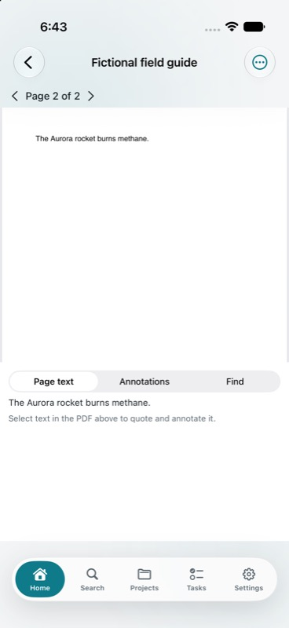

# Knowledge workflows

Open **Knowledge** on desktop, in the browser, or from iPhone Home. These additions build on [AI chat](AI_CHAT.md) and [everyday capture and review](POWER_FEATURES.md). See the [plan](KNOWLEDGE_PLAN.md) and [verification record](KNOWLEDGE_VERIFICATION.md) for implementation and acceptance status.

Workflow runs, organization suggestions and conflict analysis need your configured text provider. Recording, caption imports, collections, PDF annotations, scanned-page text and source checks work without it.

## Reusable AI workflows

Save a name, an instruction and either one branch or a keyword topic with an optional project. For example: “Review these garden notes, suggest outstanding tasks, and draft a brief for the next visit.”

Run rereads the definition and the current notes. It produces reviewed tasks, tags, reminders and briefs. Select individual operations, Apply or Discard. Guarded Undo refuses to overwrite newer work. A saved workflow never contains an executable proposal, and Run never applies changes.

Instructions can contain 4,000 characters. Existing action limits apply: 150 ordinary source items, 500 items in a branch and 50 proposed operations. Workflows run when you choose Run; they do not schedule unattended AI work.

## Organization preferences

Explicitly save instructions such as “Use short lowercase tags” or “Group garden references by season,” optionally limited to one project. Select them for each workflow run. Project preferences apply only in their project. Organize library can use selected global preferences, since its scope can span projects.

Preferences are never inferred from chats or clicks. Saving one does not enable automatic filing. Your final request takes precedence over a selected default, and organization remains a reviewed proposal. Up to ten preferences and 4,000 characters of preference context can be selected.

Recipes, preferences, collections and watched-source definitions use ordinary notes with versioned metadata. They and their nested configuration notes stay outside AI source scopes and daily review. Edit their configuration in Knowledge; editing a readable definition's body does not replace its authoritative metadata.

## Typed collections

Create a collection scoped to a project, keyword topic or item type. Add text, number, date, checkbox or select fields. Show the same items as a table, cards or a Kanban board; Kanban uses a select field for its columns. Edit or clear values, filter, sort or move an item into another option. Properties are independent of task status, reminders and tags.

A collection supports 20 fields, 50 options per select, ten filters and three sort rules. Text values have a 2,000-character limit; numbers must be finite, within ±1e15; dates are real `YYYY-MM-DD` calendar dates. Field types stay fixed. Existing field and option identities are preserved on edits. Removing a field or archiving the definition retains values on the items.

Collections evaluate the 1,000 most recently updated ordinary items in their scope before filtering and sorting. Results expose matched/evaluated counts and a capped indicator; pagination covers those evaluated results. Secret notes, decisions, saved chats, definitions, templates and archived items are excluded. Different collections' values remain independent and sync with their items.

## Audio and meeting research

Import audio or choose Record. A stopped recording is a draft: review playback, then explicitly Save recording or Discard. Recording requests microphone access only when started and stops on leaving or backgrounding the screen. Stopping never uploads it automatically.

For a saved recording, import or paste WebVTT, SubRip or timed JSON. Preview, then explicitly save the transcript. Editing the caption draft requires another preview. Reimporting the same recording and timings returns the existing transcript.

```json
{"segments":[
  {"start":0,"end":2,"text":"Welcome to the garden meeting."},
  {"start":2,"end":5,"text":"Order cedar boards.","speaker":"Alex"}
]}
```

Times are seconds from the recording's start. A transcript allows 2,000 cues and 200,000 text characters, nondecreasing starts and up to five seconds of overlap, bounded to 24 hours. Tap a cue to seek. Save up to 50 cues or 5,000 quoted characters as a passage with your own note. AI answers can carry recording timestamps; a saved transcript can also provide the branch for reviewed tasks or a brief.

Audio formats include MP3, M4A, WAV, Ogg, FLAC and WebM, up to 25 MiB for import/transcription. PDF/audio previews read up to 32 MiB. Originals, searchable transcripts and passages remain linked and exportable. Attachment bytes are not automatically mirrored to iPhone's ordinary offline library.

### Optional transcription

Configure the speech server address, model and optional key on the desktop host. This is separate from the text AI provider. A local compatible server can be used; Petty Memory never installs or downloads a speech model.

Self-hosted servers use these environment variables:

```sh
MEMORY_TRANSCRIPTION_URL=http://127.0.0.1:8080/v1
MEMORY_TRANSCRIPTION_MODEL=your-speech-model
# Set MEMORY_TRANSCRIPTION_KEY only if the server requires a key.
```

The endpoint must support multipart `/audio/transcriptions`, `verbose_json` and segment timestamps. OpenAI's `whisper-1` supports this format; other transcription models do not necessarily accept it. See the [official timestamp documentation](https://developers.openai.com/api/docs/guides/speech-to-text#timestamps).

Confirm the destination for each recording before sending it. The result is a preview; saving is separate. Keys use OS-encrypted desktop storage or host environment variables, never notes, content sync or exports. Redirects are refused, requests time out after two minutes and responses are capped at 4 MiB. Caption import works with transcription off. Adapter tests do not establish speech accuracy.

## PDF research

Import a PDF file, open Research, navigate or search by page, and annotate a selected quote. Older PDFs can be indexed again. Annotations retain the exact source quote, page, attachment hash and surrounding text; repeated text can be distinguished by occurrence. Originals are never rewritten.

AI retrieval returns a supporting page's text with its locator. Your own note on a PDF is separate evidence and does not acquire a fabricated page location. Annotations report moved/stale quotes or missing/changed sources. A link saved as extracted PDF text alone needs an imported PDF file for the document viewer.

For a scan, recognize the actual selected page, review and correct its text, then Save recognized page. Desktop and browser render locally and use the host's bundled English Tesseract. iPhone uses PDFKit and Vision locally, off the main thread. No LLM is involved. Reviewed OCR text can supply source-linked annotations; accuracy depends on the scan and language.

The page index retains up to 2,000 pages, 100,000 characters per page and 2 MiB total. Counts, clipped pages and truncation are explicit; page numbers never shift. OCR can supply reviewed text beyond the retained text range. Annotations quote up to 5,000 characters with optional notes up to 20,000. Recognition retains existing image byte/pixel limits.

On iPhone, select PDF text or choose **PDF actions → Annotate a passage…** and enter an exact quote. The menu also works for reviewed OCR on image-only pages.



## Watched sources

Create a URL, RSS/Atom feed or folder watch. Checks queue new/changed material; they never import it or replace a saved source automatically. Review candidates and Apply selected. Changed pages retain your note and normal history. Changed files become immutable snapshots connected to their earlier source, which remains available. Stale previews fail before writing.

Approve folders only through the desktop's local picker. Browser and iPhone can check an approved folder but cannot supply arbitrary host paths. Approvals, paths and queues are device-local and excluded from content sync/export. Restoring a backup requires folder approval again. Deleting a definition clears its local approval and queue.

Folder checks cover the top level, ignore hidden files/symbolic links, and support Markdown, plain text and PDF. A pass considers 200 files, 20 MiB per file and 64 MiB of changed bytes. Apply checks hashes again and accepts up to 20 candidates/64 MiB together. Existing identical files are skipped; archived imports are not silently revived.

URL/feed checks fetch up to 2 MiB, inspect up to 50 entries and keep up to 100,000 characters per candidate. Truncation, skips and failures are shown. Relative links are resolved; scripts and declared XML entities are not executed. Feed `xml:base` is not interpreted and XHTML content may become plain text. Disabling link fetching disables URL/feed checks.

Feed summaries stay separate from manually saved articles. Reverting a watched file to earlier bytes creates a fresh snapshot sharing the same stored bytes, preserving a one-way version chain and leaving unrelated identical files unchanged.

Periodic checking starts off. Enabled watches are due every six hours while the host runs; the worker polls every 15 minutes, checking up to five due watches per pass. Manual Check is available. Refresh an open source list for its latest queue. No automatic import or unattended AI action runs.

## Information review

Choose an age to find items not edited or checked recently. Mark checked records a review date without changing the text. Published, captured, edited and checked dates remain distinct.

For conflict analysis choose a branch, topic or project. Suggestions must quote exact excerpts from two different selected items. Fabricated quotes/unknown references are rejected. No evidence means no supported suggestion was found in the bounded text examined; it is not proof that the whole library agrees.

Review quotes, dates and the neutral reason. Dismiss the pair, mark an item checked, or explicitly select which ordinary note supersedes the other. Both texts remain. Supersession is a permanent logged connection and later AI answers prefer the current note. Append-only decisions use their existing decision-log workflow. Changed source hashes refuse stale review actions.

Analysis is limited to 100 ordinary items and 40,000 model-context characters; branches can contain 500 items. Excerpts/context may be clipped. The stale list returns up to 100 items and the total. Analysis reports scanned, rejected and dismissed counts. Suggestions never silently rewrite a claim.

## Client boundaries

Knowledge configuration and reviewed changes need the host. Complex writes are not queued offline. Accepted ordinary notes and metadata retain normal history/export/sync. Daily review is distinct from freshness review and source checking. Physical microphones, real speech accuracy and distribution gates are recorded in [verification](KNOWLEDGE_VERIFICATION.md).
