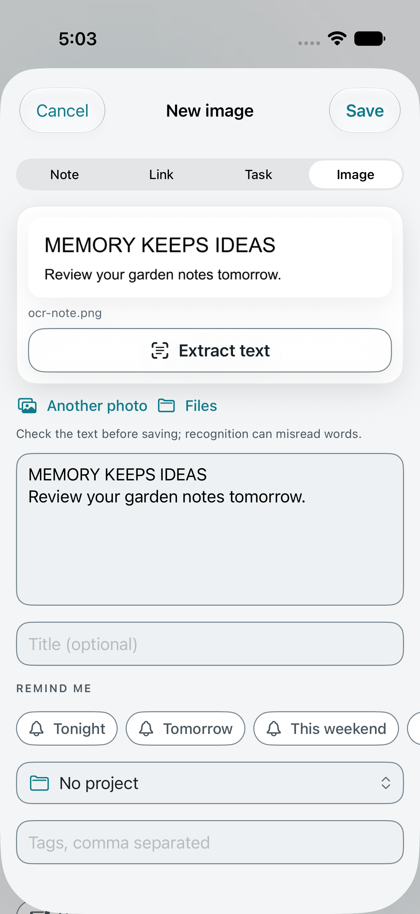
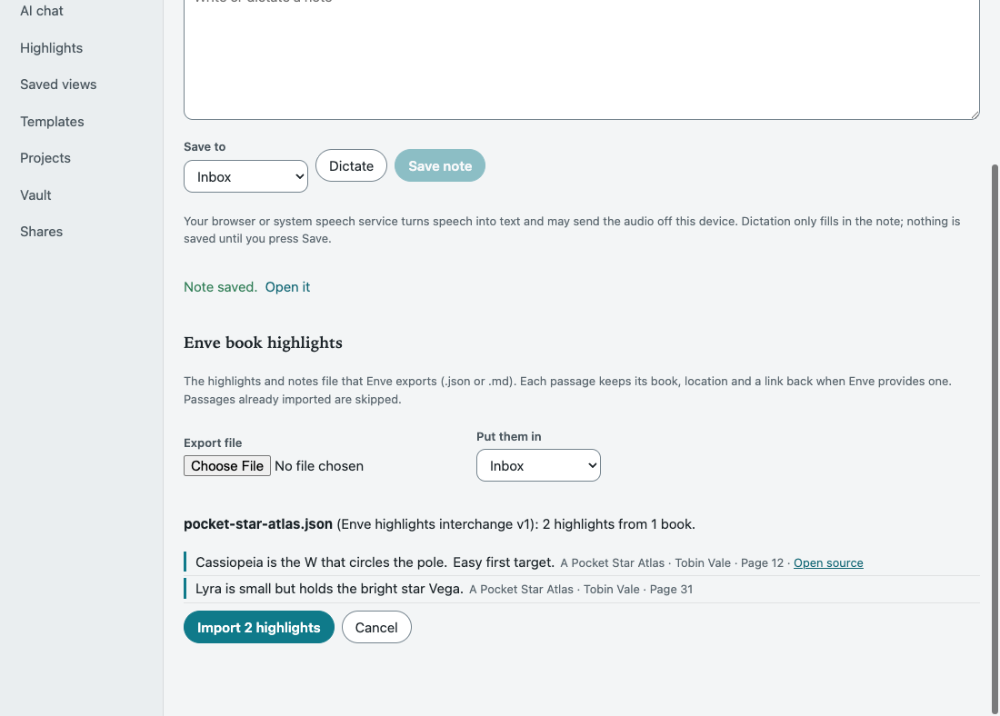

# Everyday workflows

These workflows extend the [public feature comparison](../README.md#daftak-feature-comparison) and the [AI chat layer](AI_CHAT.md). Most of them work without an AI provider. Nothing here changes your library until you press a button, and every write is logged in History like any other change.

| Workflow | Needs an AI provider | Desktop | Browser | iPhone |
|---|---|---|---|---|
| [Saved chats](#saved-chats) | To chat; saved chats open without one | AI chat → Save chat, Saved chats | AI chat → Save chat, Saved chats | AI chat → Save, Home → Saved chats |
| [Suggested actions](#suggested-actions) | Yes | AI chat → Suggest actions | AI chat → Suggest actions | AI chat → Actions |
| [Topic suggestions](#topic-suggestions-when-organizing) | Yes, plus local semantic search | Organize library | Organize library | Organize |
| [Note dictation](#note-dictation) | No | Capture bar | Capture & import | New note |
| [Text from images](#text-from-images) | No | Item → Text in the image | Item → Extract text | New → Image, or an attachment |
| [Daily review](#daily-review) | No | Review | Review | Home → Daily review |
| [Connections and duplicates](#connections-and-duplicates) | No | Item → Find connections | Item → Find connections | Item → Find connections |
| [Enve book highlights](#enve-book-highlights) | No | Settings → Import | Capture & import | Settings → Import Enve highlights |
| [Getting started](#getting-started) | No | Home | Above the outline | Home |

On iPhone, saved-chat operations, AI actions, review scheduling, merges and imports need a connection to your computer and a pairing with read and write access; they are never queued. Ordinary note and image capture, including saving extracted text as a new note, uses the normal outbox.

## Saved chats

Chats are not stored unless you save them. Until then a conversation lives only on the open chat screen or browser tab.

**Save chat** stores the conversation as an ordinary note: a readable transcript, plus the exact messages so the chat can be reopened. Saving again updates the same note. Changing the mode, project, branch or topic starts a new, unsaved conversation.

- **Find and reopen.** Saved chats lists the 100 newest that match your search, and the search covers every saved chat in the library. Reopening restores the mode, context and messages, so you can continue.
- **Proposals are summaries.** A saved chat keeps the text of each reply. An edit, organization or action proposal is kept only as its summary and can't be applied again from history. Ask again for a fresh proposal.
- **Limits.** A saved chat holds up to 100 messages and 200,000 characters. Longer conversations keep the newest whole exchanges and tell you how many older ones were left out.
- **Archive.** Archiving hides a saved chat. Nothing is deleted.
- **Save as note.** Any cited answer can become its own note. Its numbered citations become item references, followed by a list of sources.

Saved chats are plaintext notes. They sync, appear in ordinary search and history, and are included in exports. Do not save a chat you would not keep as a plain note. Saved chats are left out of daily review, connection suggestions, suggested actions and topic organization.

Use Save in AI chat to update the messages used when resuming. Editing the transcript as an ordinary note changes its displayed text; it doesn't rewrite the structured chat messages.

## Suggested actions

Choose **Suggest actions**, then pick one branch or name a keyword topic, with an optional project for a topic. For example:

> Find the follow-ups in my garage notes and remind me about anything with a date.

The AI can propose four kinds of change:

- **Tasks**, with an optional due date and source note.
- **Tags**, from one to eight per item.
- **Reminders** on existing items.
- **A brief**, a new note that summarizes its source notes.

Each operation has its own checkbox. Nothing changes until you apply, and the ticked operations apply together or not at all. New tasks and briefs link back to their sources and are filed in the topic's project, or in their sources' project when they share one.

A topic matches ordinary items containing every word you give, up to 150 items. A branch can hold up to 500 items overall and 150 eligible source items. A proposal has at most 50 operations and can only refer to items in the scope you chose. This mode can create tasks and briefs, add tags and set reminders. Secrets, decisions, templates, saved views and saved chats are left out. A branch containing a secret note is refused.

**Stale proposals are refused.** If anything in the scope changes, or a new item starts matching the topic, applying fails and you need a fresh proposal. On iPhone your ticks are kept.

**Undo** archives the tasks and briefs that were created, and restores the earlier tags and reminders. Undo is refused once anything it touched has changed again; use History to recover individual changes instead. A repeated Apply returns the original result and never refreshes the undo guard over newer work.

## Topic suggestions when organizing

[Organize library](AI_CHAT.md#organize-notes-across-the-library) still finds every keyword match for a topic. When semantic search is available, it also adds up to 50 notes found by meaning, within the same 150-note limit. These are marked **Suggested**. Check them before moving anything, because they come from a short top-results list and are not a complete set.

If semantic search is off, or not supported (for example on Intel Macs), organization uses keyword matches only. If the semantic lookup fails, the proposal says it includes keyword matches only.

## Note dictation

**Dictate** fills a new note's text and never saves it for you. Stop, check the words, then Save. Dictation starts only when you tap Dictate, and permission is requested at that point, never before.

Speech recognition is done by your platform, not by your configured AI provider, and its privacy terms are separate:

- **iPhone** recognizes on the phone when the language supports it. Otherwise the screen says Apple's speech service processes the audio.
- **Supporting browsers** use the Web Speech API. The browser's speech service may process audio remotely.
- **Desktop and other browsers** explain how to use operating-system dictation in the text field instead.

Dictation doesn't save audio. It stops when you leave the screen or the app goes to the background. [Research recording](KNOWLEDGE_FEATURES.md#audio-and-meeting-research) separately lets you record and explicitly save audio. See [AI_CHAT.md](AI_CHAT.md#dictation) for dictating chat messages.

## Text from images

Image text extraction never uses your AI provider or a cloud service.

- **Desktop and browser.** Open an image item and choose **Extract text**. The computer that holds the library reads it with the bundled English Tesseract engine. In the browser, that work also happens on the host, not in the tab. It reads PNG, JPEG, WebP, TIFF and BMP images up to 20 MB and 25 million pixels, one image at a time. HEIC images need converting first.
- **iPhone.** **New → Image** lets you choose a photo or file, or the camera on a device. **Extract text** reads it with Apple's Vision framework on the phone. Images already in the library can be read by the computer from their attachment row.

You always get an editable draft first. Correct it, then save. On desktop and in the browser, saving creates a new note that refers to the image. On iPhone, a new image is uploaded with the text as its note. The original image is kept unchanged in both cases. Recognition quality depends on the image. On iPhone, camera capture and on-device recognition still need a physical-device acceptance run.



## Daily review

**Review** shows a short queue of knowledge to look at again. Use it to revisit useful notes over time. Review marks still flag notes that need fixing. The queue lists:

1. Items that are due, oldest due date first.
2. Pinned, high-attention or review-marked items that have never been reviewed.
3. Everything else not reviewed yet, oldest first.

For each card, choose **Tomorrow**, **Next week**, **Next month** or any number of days from 1 to 3,650. Cards open as ordinary items, and you can filter the queue by project.

Notes, links, files and images can be reviewed. Tasks, decisions, secret notes, saved chats, saved views, templates and archived items are left out.

The schedule and the last 50 reviews are stored on the item, so they sync and appear in its history. Review is a list you open. There is no background review service and no review notification. If you want a nudge, set an ordinary reminder. On iPhone, review needs a connection. A read-only pairing can view the queue but can't reschedule.

## Connections and duplicates

On an item, **Find connections** suggests three kinds of connection. No AI is involved:

- **Unlinked mentions**: another item contains this item's title, or this item contains another's, and they aren't linked yet.
- **Related**: notes that share distinctive words, with the shared words shown.
- **Possible duplicates**: notes with at least 60% of the same wording.

Each list shows up to 10 suggestions. The search compares the newest 1,000 eligible items and says how many it looked through. Items already connected or referenced either way, and the item's own parent and children, aren't suggested as mentions or related notes. Secrets, decisions, saved chats, saved views, templates and archived items are left out.

**Connect** adds an ordinary "related to" connection, which you can remove later. Your explicit references and backlinks stay authoritative.

**Merge** a duplicate into the note you keep. The preview shows the combined title and text, how many nested notes will move, and how many files stay with the other note. Merging then:

- adds the other note's text to the kept note,
- moves its nested notes under the kept note,
- archives the other note, with its files still attached, instead of deleting it.

A merge is refused if either note, or anything inside them, has changed since the preview. It is also refused for anything other than two ordinary notes, if either branch contains a secret, or if the merge would touch more than 500 items. Undo reverses the whole merge as one editor action. The original stays recoverable from the archive and from History.

## Enve book highlights

Import highlights, annotations and bookmarks from an Enve Book Player export. Enve exports these from its **Export** sheet as JSON or Markdown.

1. Choose the export file, up to 2 MB and 1,000 passages.
2. Review the preview: passages, books and any entries skipped.
3. Pick a project, or leave the passages in the Inbox, and import.

Each passage becomes an ordinary note titled with its book and location. The note quotes the passage, includes your annotation, names its source, and is tagged `enve` and `highlights`.

**Importing again is safe.** Passages you have already imported are skipped, as are repeats within one file. To bring in new highlights, export again from Enve and import the new file. Only the chosen file is read; Petty Memory never reads Enve's private app data.

Enve's export includes the book title, author, reading position and your text, but no book identifiers or source links. These exports retain provenance as text. Later edits or deletions in Enve don't carry over; importing is a snapshot, with no live sync. A file that explicitly supplies a source link can open it from the preview and imported note.

### Interchange format

Other tools can produce a version 1 interchange file, which may include a link for each passage:

```json
{
  "format": "petty-memory-enve-highlights",
  "version": 1,
  "entries": [
    {
      "id": "stable-source-id",
      "bookTitle": "The Fictional Garden",
      "author": "A. Writer",
      "text": "Plant the beans after the last frost.",
      "note": "Check the date for our area.",
      "location": "Chapter 3 · 42%",
      "sourceUrl": "https://example.com/book/3#p42"
    }
  ]
}
```

`bookTitle` is required, and each entry needs `text`, `note` or both. With a stable `id`, a passage keeps its identity when its text changes: re-importing that ID skips the entry and preserves the existing note. `sourceUrl` is optional. It must be an `http`, `https` or `enve` link without credentials. Choose Open source to open it; an `enve` link also needs an app that handles the supplied URL. Petty Memory doesn't construct missing links or check where they lead.



## Getting started

A dismissible checklist points at capture, import, daily review and optional AI setup. Desktop adds connecting an AI tool, and the browser adds saved chats. It also explains that an AI provider is optional and that a cloud provider receives the notes you chat about. The checklist never changes the library or turns AI on.

- **Desktop** shows it on Home for libraries with 20 or fewer items.
- **Browser** shows it above the outline for write tokens, in libraries with 20 or fewer items. Hiding it is remembered for that token in that browser.
- **iPhone** shows it on Home until you hide it. Settings can bring it back.

## From the CLI and API

On the computer that holds the library:

```bash
petty-memory conversations [show <id> | save <file> | archive <id> --yes]
petty-memory review [-p project] [--limit N]
petty-memory review schedule <id> --days 7
petty-memory insights <id> --json
petty-memory ai actions <root-id> "Find follow-ups"   # preview only
petty-memory ai actions-apply proposal.json [--exclude <operation-id>]
petty-memory ai actions-undo receipt.json
petty-memory ocr <attachment-id>                      # prints text; saves nothing
petty-memory import highlights export.json [-p project] [--preview]
```

The [HTTP API](API.md) covers `/conversations`, `/review`, `/items/:id/insights`, `/insights/merge`, `/ai/actions/apply` and `/ai/actions/undo`, `/capture/ocr` and `/imports/enve-highlights`. Reads need `read`. Writes, OCR and import previews need `write`. Chat requests, OCR and the import and merge previews are never stored in the API's idempotency replay cache. The MCP server does not expose these workflows.
